# Restaurant Management API

Production-oriented restaurant management module for a Spring Boot food-delivery application.

This document describes the current **Restaurant** REST API, including endpoint contracts, request/response behavior, validation rules, sequence diagrams, flowcharts, and service-level pseudocode.


---

## Table of Contents

- [Architecture Overview](#architecture-overview)
- [API Conventions](#api-conventions)
- [Endpoint Collection](#endpoint-collection)
- [Data Contracts](#data-contracts)
- [1. View Restaurant](#1-get-cart)
- [2. Add Restaurant](#2-add-item-to-cart)
- [3. Update Restaurant](#3-update-cart-item-quantity)
- [4. delete Restaurant](#4-remove-single-cart-item)
- [Validation and Error Handling](#validation-and-error-handling)
- [Persistence Notes](#persistence-notes)
- [Future Authentication Refactor](#future-authentication-refactor)

---

# Architecture Overview

The restaurant module is modeled around `User` as the main business resource and `Restaurant` as a child resource.

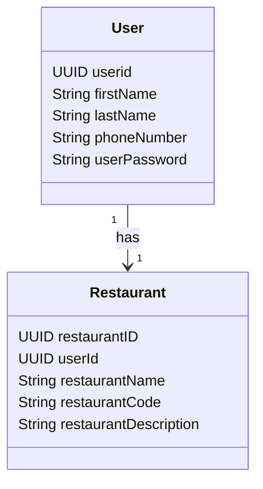

Recommended Spring Boot responsibility split:

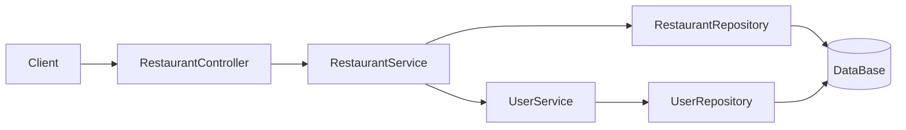

### Controller responsibilities
.

- `RestaurantController`
    - Add a restaurant.
    - Update a restaurant.
    - Remove a restaurant.
    - view a restaurant.

### Service responsibility

`RestaurantService` owns user business operations.


---

# API Conventions

Base path:

```text
/api/v1
```

Current customer-scoped cart path:

```text
/api/v1/restaurant
```

General rules used by this API:

1. Resource identity belongs in the URL.
2. Operation data belongs in the request body.
3. `restauantIs` and `userId` are generated by the backend. 
4. All properties must be not bull except description of restaurant

---

# Endpoint Collection

| Feature            | HTTP     | Endpoint                         | Body                         | Success       |
|--------------------|----------|----------------------------------|------------------------------|---------------|
| View a Restaurant  | `GET`    | `/api/v1/restaurants/{restaurant-d}` | None                         | `200 OK`      |
| Add a Restaurant   | `POST`   | `/api/v1/restaurants`            | `AddRestaurantRequestDto`    | `201 CREATED` |
| Update a Restaurnt | `PUT`    | `/api/v1/restaurants`            | `UpdateRestaurantRequestDto` | `200 OK`      |
| Delete a Restaurnt | `DELETE` | `/api/v1/customers/{customerId}` | None                         | `204 No Content` |


# Data Contracts

## AddRestaurantRequestDto

```java
public record AddRestaurantRequestDto(
        @Size(max = 10)
        @NotNull(message = "the restaurant's code is required")
        String restaurantCode,
        @NotNull(message = "the restaurant's name is required")
        String restaurantName,
        String restaurantDescription,
        @NotNull AddUserRequestDto addUserRequestDto
) {
}

public record AddUserRequestDto(
        @NotNull(message = "first name is required")
        String firstName,
        @NotNull(message = "last name is required")
        String lastName,
        @NotNull(message = "phone number is required")
        String phoneNumber,
        @NotNull(message = "user password is required")
        String userPassword
) {
}

```

Example:

```json
{
  "restaurantCode": "123456",
  "restaurantName": "tamim", 
  "restaurantDescription" : "food is very nice", 
  "addUserRequestDto" : {
    "firstName" : "tamin", 
    "lastName" : "restaurant", 
    "phoneNumber" : "010121456321", 
    "userPassword" : "asd20210EESS@@#1010"
  }
}
```

---

## UpdateRestaurantRequestDto

```java
public record UpdateRestaurantRequestDto(
        @NotNull(message = "the id of restaurant is required")
        UUID restaurantId,
        @NotNull(message = "the restaurant's code is required")
        String restaurantCode,
        @NotNull(message = "the restaurant's name is required")
        String restaurantName,
        String restaurantDescription,
        @NotNull UpdateUserRequestDto userRequestDto
) {
}

public record UpdateUserRequestDto(
        @NotNull(message = "the id of user is required")
        UUID userId,
        @NotNull(message = "first name is required")
        String firstName,
        @NotNull(message = "last name is required")
        String lastName,
        @NotNull(message = "phone number is required")
        String phoneNumber,
        @NotNull(message = "user password is required")
        String userPassword
) {
}

```

Example:

```json
{
  "restaurantId" : "23d4236f-abb7-4edc-8899-7f1628989fa3",
  "restaurantCode": "123456",
  "restaurantName": "Tamim restaurant",
  "restaurantDescription" : "",
  "addUserRequestDto" : {
    "userId" : "102e6e75-974f-40bc-b4fc-86e955842fad",
    "firstName" : "tamin",
    "lastName" : "restaurant",
    "phoneNumber" : "01563248698",
    "userPassword" : "as200dasdqw@@#1010"
  }
}
```

---


## RestaurantResponseDto

```java
public record RestaurantResponseDto(
        UUID restaurantId,
        String restaurantCode,
        String restaurantName,
        String restaurantDescription,
        UserResponseDto userResponseDto
) {
}

public record UserResponseDto(
        UUID userId,
        String firstName,
        String lastName,
        String phoneNumber
) {
}
```

---

## ErrorResponse

```java
@Builder
public record ErrorResponse(
        String status,
        String message,
        LocalDateTime timestamp
) {
}
```

Example:

```json
{
  "status": "BAD_REQUEST",
  "message": "quantity: Quantity must be greater than zero",
  "timestamp": "2026-08-29T18:30:00"
}
```

---

# 1. View a Restaurant

## Endpoint

```http
GET /api/v1/restaurants/{restaurant-id}
```

Returns the restaurant.

### Example response

```json
{
  "restaurantId" : "23d4236f-abb7-4edc-8899-7f1628989fa3",
  "restaurantCode": "123456",
  "restaurantName": "Tamim restaurant",
  "restaurantDescription" : "tamim is only one ",
  "addUserRequestDto" : {
    "userId" : "102e6e75-974f-40bc-b4fc-86e955842fad",
    "firstName" : "tamin",
    "lastName" : "restaurant",
    "phoneNumber" : "01563248698"
  }
}
```

## Sequence Diagram

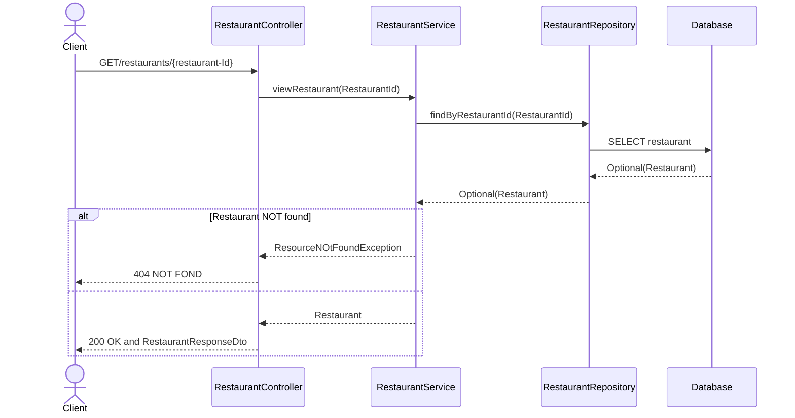

## Flowchart

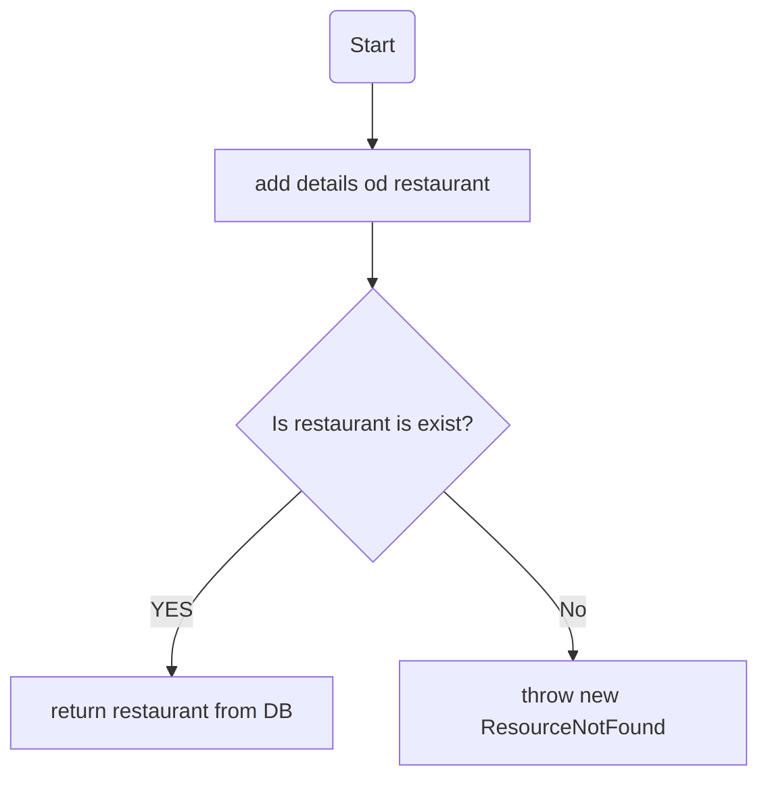

## Pseudocode

```text
FUNCTION ViewRestaurant(restaurantId):
     RETURN restaurantRepository.findById(restaurantId)
     .orElseThrow(()-> new ResourceNotFoundException("the restaurant is not found"));
```

---

# 2. Add Restaurant 

## Endpoint

```http
POST /api/v1/restaurants
Content-Type: application/json
```

Request:

```json
{
  "restaurantCode": "123456",
  "restaurantName": "tamim",
  "restaurantDescription" : "food is very nice",
  "addUserRequestDto" : {
    "firstName" : "tamin",
    "lastName" : "restaurant",
    "phoneNumber" : "010121456321",
    "userPassword" : "asd20210EESS@@#1010"
  }
}
```

## Sequence Diagram

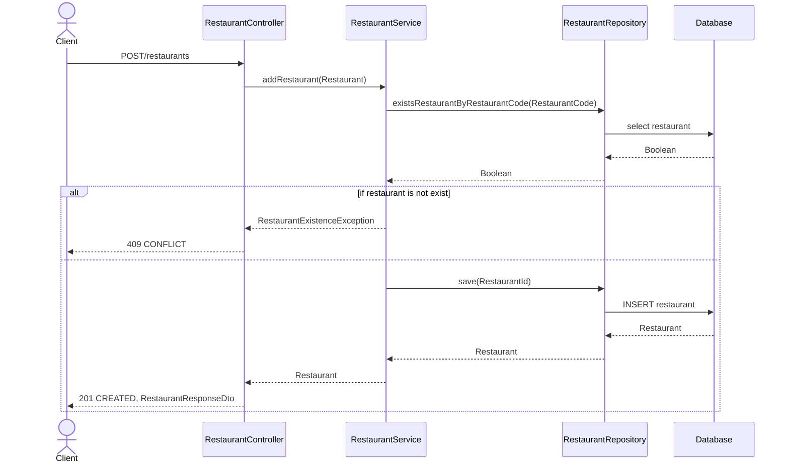

## Flowchart

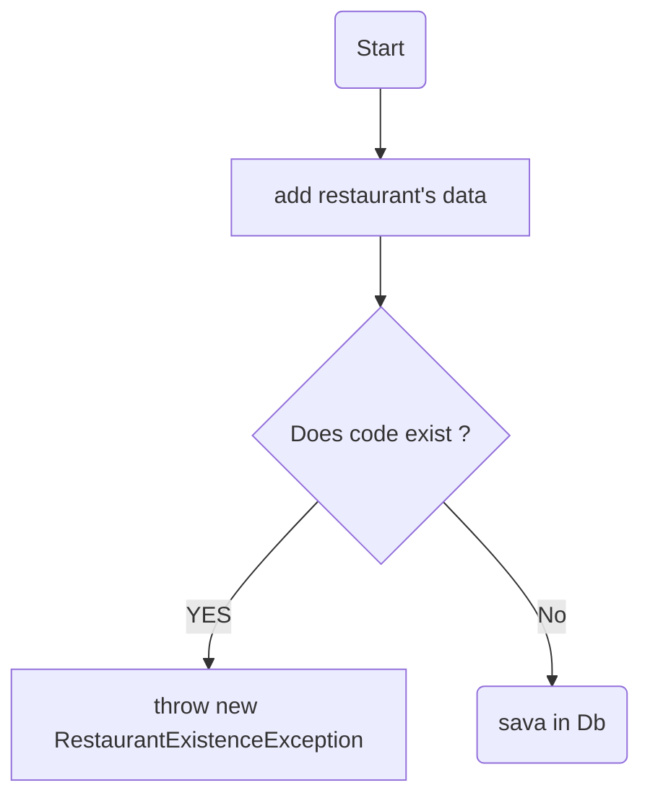

## Pseudocode

```text
FUNCTION addToCart(request):

    IF Restaurant does not exist: 
        THROW RestaurantExistenceException

    Restaurant restaurant = repo.sava(request) 
    
    RETURN restaurant
```

---

# 3. Update Restaurant

## Endpoint

```http
PATCH /api/v1/restaurant
Content-Type: application/json
```

Request:

```json
{
  "restaurantId" : "23d4236f-abb7-4edc-8899-7f1628989fa3",
  "restaurantCode": "123456",
  "restaurantName": "Tamim restaurant",
  "restaurantDescription" : "",
  "addUserRequestDto" : {
    "userId" : "102e6e75-974f-40bc-b4fc-86e955842fad",
    "firstName" : "tamin",
    "lastName" : "restaurant",
    "phoneNumber" : "01563248698",
    "userPassword" : "as200dasdqw@@#1010"
  }
}
```


## Sequence Diagram

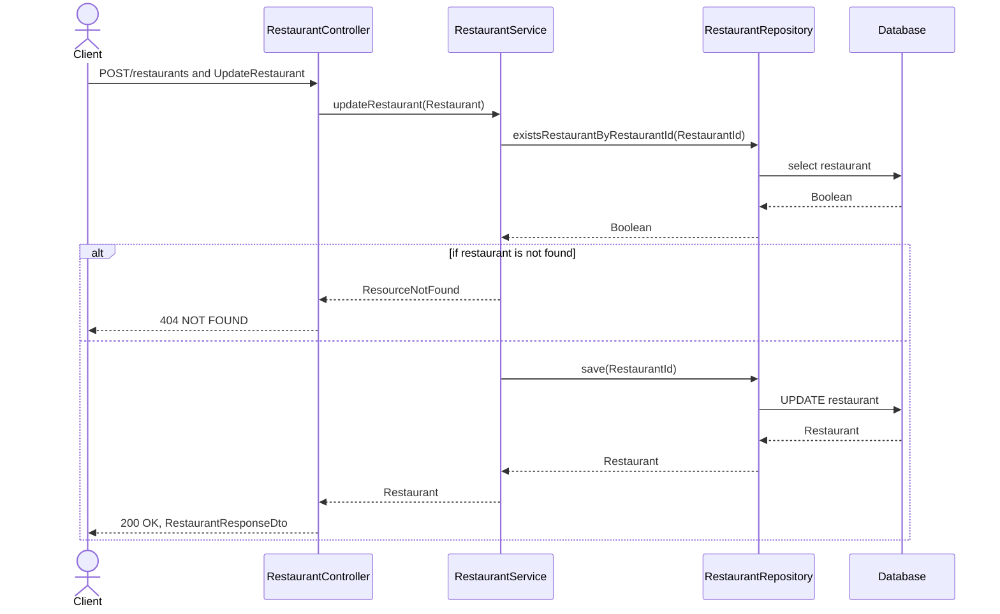

## Flowchart

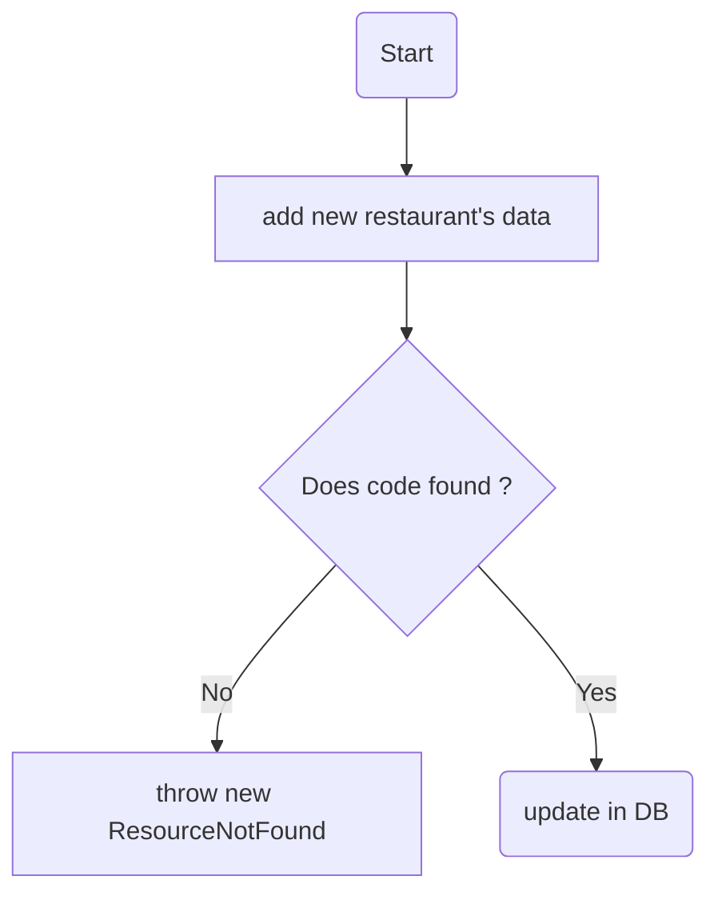

## Pseudocode

```text
FUNCTION updateRestaurant(request): 

    IF restaurant does not found:
        THROW ResourceNotFound
        
    Restaurant restaurant = sava(request) // save in JPA is also update entity

    RETURN restaurant
```

---

# 4. Remove Restaurant

## Endpoint

```http
DELETE /api/v1/restaurants/{restaurant-id}
```

Successful response:

```http
204 No Content
```

## Sequence Diagram

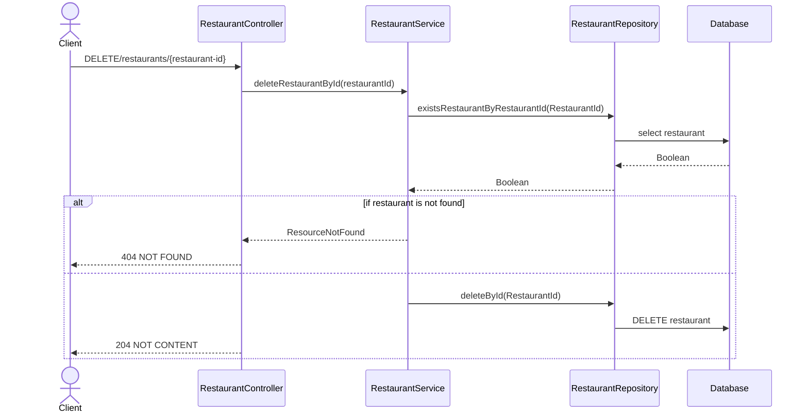

## Flowchart

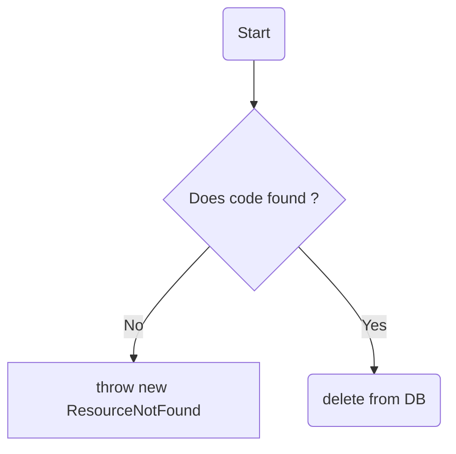

## Pseudocode

```text
FUNCTION removeRestaurant(restaurantId):

    IF restaurant does not found:
        THROW ResourceNotFound 
        
    deleteById(restaurantId)

    RETURN no content
```

---


# Validation and Error Handling

Request DTO validation uses Jakarta Bean Validation. 

Example:

```text
        @NotNull(message = "the id of restaurant is required")
        UUID restaurantId,
        @NotNull(message = "the restaurant's code is required")
        String restaurantCode,
        @NotNull(message = "the restaurant's name is required")
        String restaurantName,
        String restaurantDescription,
        @NotNull UpdateUserRequestDto userRequestDto
```

A global validation handler can collect field errors:

```java
@ExceptionHandler(MethodArgumentNotValidException.class)
public ResponseEntity<ErrorResponse> handleValidationException(
        MethodArgumentNotValidException ex) {

    String errors = ex.getBindingResult()
            .getFieldErrors()
            .stream()
            .map(error ->
                    error.getField() + ": " + error.getDefaultMessage()
            )
            .collect(Collectors.joining(", "));

    ErrorResponse response = ErrorResponse.builder()
            .status(HttpStatus.BAD_REQUEST.name())
            .message(errors)
            .timestamp(LocalDateTime.now())
            .build();

    return ResponseEntity
            .status(HttpStatus.BAD_REQUEST)
            .body(response);
}
```

Generic internal server errors should not expose internal implementation details:

```java
@ExceptionHandler(Exception.class)
public ResponseEntity<ErrorResponse> handleInternalServerError(
        Exception ex) {

    log.error("Unhandled exception occurred", ex);

    ErrorResponse response = ErrorResponse.builder()
            .status(HttpStatus.INTERNAL_SERVER_ERROR.name())
            .message("An unexpected error occurred")
            .timestamp(LocalDateTime.now())
            .build();

    return ResponseEntity
            .status(HttpStatus.INTERNAL_SERVER_ERROR)
            .body(response);
}
```

Recommended error mapping:

| Condition                        | HTTP |
|----------------------------------|---|
| Invalid request body             | `400 Bad Request` |
| Restaurant not found / not owned | `404 Not Found` |
| Restaurant existence             | `409 Conflict` or domain-specific `400` |
| Unexpected server error          | `500 Internal Server Error` |

---


## Relationship Mapping

Recommended relationship:

```java
@Entity
public class User {
  @Id
  @GeneratedValue(strategy = GenerationType.UUID)
  private UUID userId;

  @Column(name = "first_name")
  private String firstName;

  @Column(name = "last_name")
  private String lastName;

  @Column(name = "phone_number")
  private String phoneNumber;

  @Column(name = "user_password")
  private String userPassword;
}
```

```java
@Entity
public class Restaurant {
  @Id
  @GeneratedValue(strategy = GenerationType.UUID)
  private UUID restaurantId;

  @Column(name = "restaurant_code",nullable = false, unique = true)
  private String restaurantCode;

  @Column(name  = "restaurant_name")
  private String restaurantName;

  @Column(name = "restaurant_description")
  private String restaurantDescription;

  @OneToOne(cascade = CascadeType.ALL)
  @JoinColumn(name = "user_id")
  private User user;
}
```

`Restaurant` owns the relational foreign key because `restaurant.user_id` is physically stored in the child table.

---

# Future Authentication Refactor

Current API:

```text
GET    /restaurants/{restaurant-id}
DELETE /restaurants/{restaurant-id}

POST   /restaurants
PATCH  /restaurants
DELETE /restaurants

```

The service contract can remain largely unchanged:

```java
RestaurantService.addRestaurant(restaurant);
RestaurantService.updateRestaurant(restaurant);
RestaurantService.deleteRestaurantByID(restaurantId);
RestaurantService.getRestaurantById(restaurantId);
```

--- 


# Summary

The cart API follows these core design decisions:

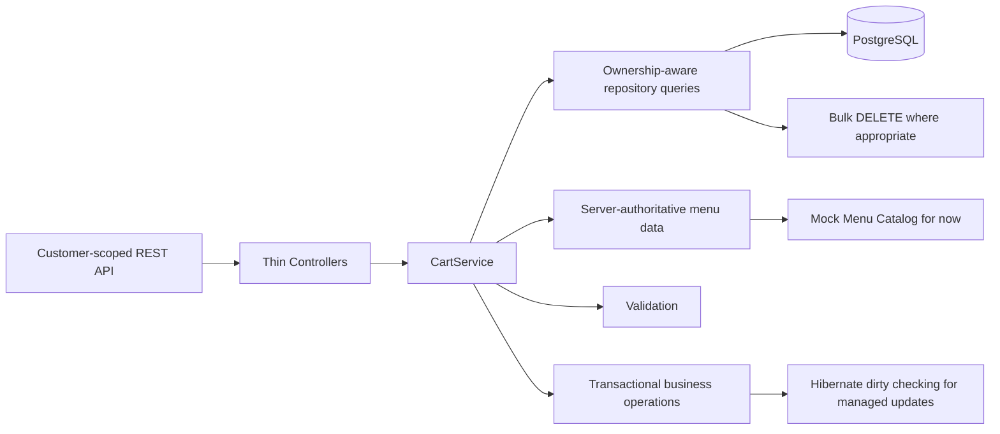

The most important rules are:

- Keep `customerId` in the path only until authentication is available.
- Never trust client-supplied price.
- Use `cartItemId` in the path when addressing an existing item.
- Keep quantity changes explicit with `PATCH`.
- Keep removal explicit with `DELETE`.
- Use one bulk database delete for batch removal and clear-cart operations.
- Enforce ownership inside repository predicates where practical.
- Keep `Cart` as the aggregate-level business concept even when controllers are separated.